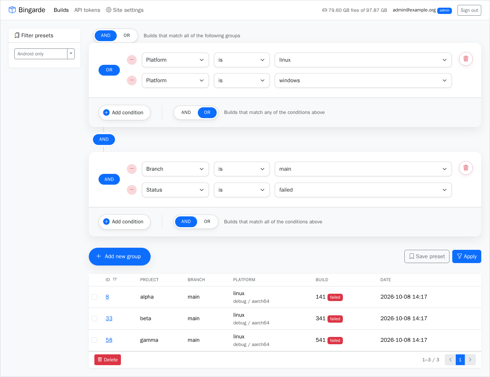
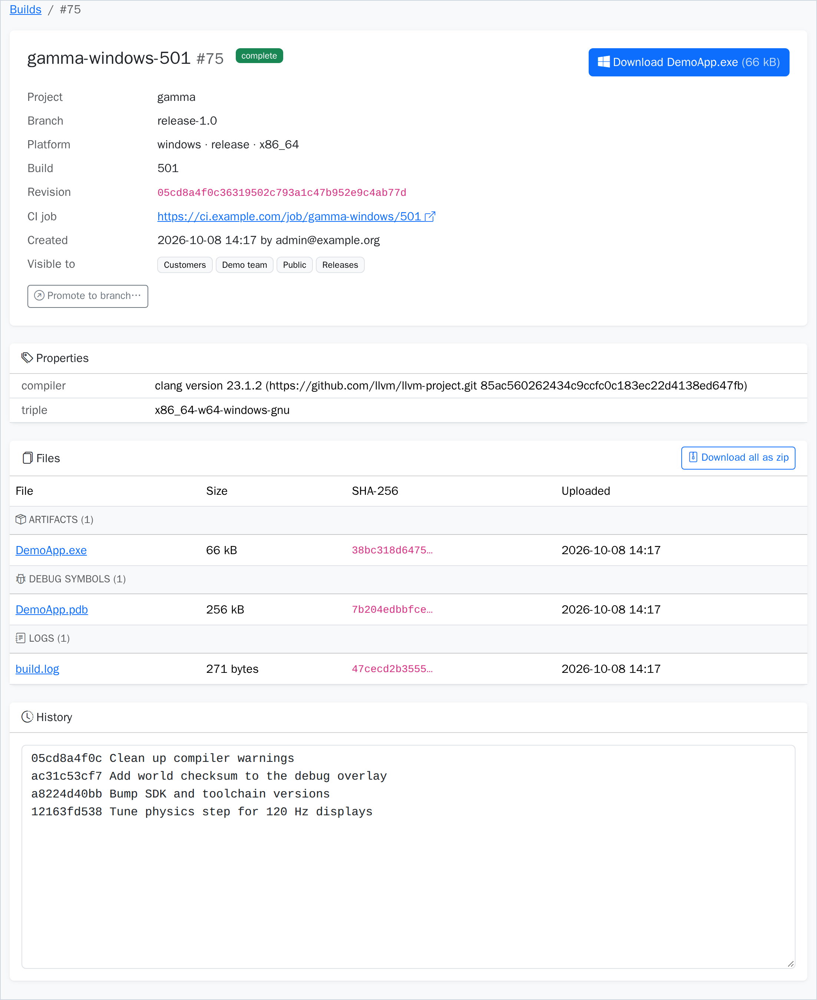
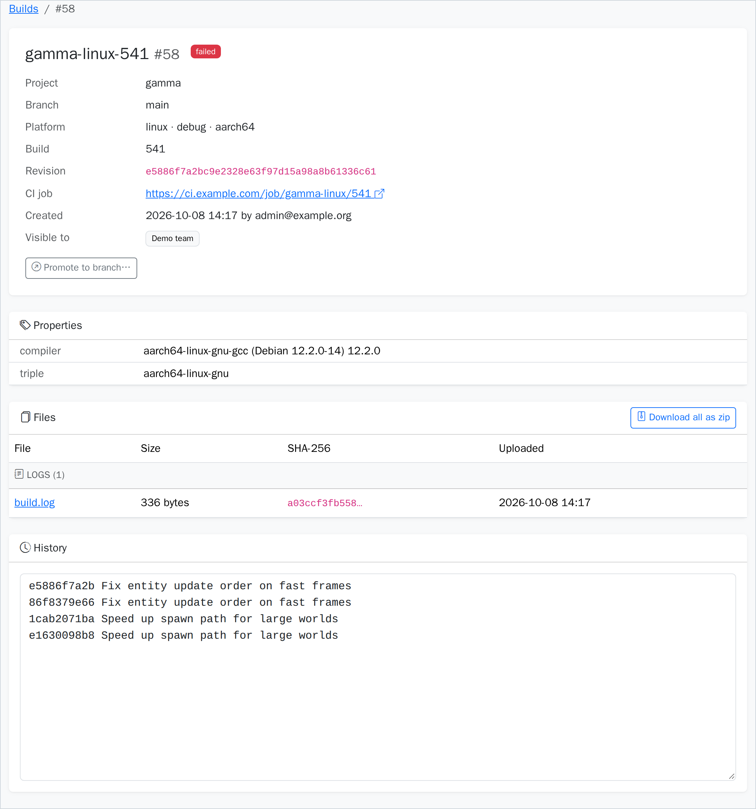

# Bingarde

A self-hosted store for CI build artifacts. CI jobs upload builds through a small REST API.
People browse, filter and download them in a web UI.

Each build keeps its installers, debug symbols (`.pdb`, `.dSYM`, `.debug`), logs and test
reports together, with the commit, status, config, architecture and a link to the CI job.



## Features

- **REST API for CI.** Create a build, upload its files, then mark it `complete` or `failed`.
  A rerun of the same CI build reuses its record instead of making a duplicate.
- **Typed files with checksums.** Every file gets a role (artifact, symbols, log, report, other)
  and a SHA-256. Uploading the same file twice keeps one copy.
- **Condition builder.** Filter builds with any number of AND/OR groups on project, branch,
  platform, config, arch, build number, revision, status and date. Save filters as presets.
- **Fast, protected downloads.** The app checks the login, then nginx sends the file
  (`X-Accel-Redirect`). Big uploads stream to disk without buffering. Download a whole
  build as one zip.
- **Login.** Google sign-in (OpenID Connect with PKCE) for people, scoped API tokens
  (`read` / `write`) for CI. Only token hashes are stored. Forms are CSRF-protected.

| Build page | Failed build |
|---|---|
|  |  |

The demo data in the screenshots is real: a small C project built with MSVC (Windows),
gcc (Linux x86_64 and aarch64) and Xcode (iOS, macOS). Its sources and build scripts
live in a separate repo, linked here as the [`demo/`](demo/) submodule.

## Quick start

You need Docker with `docker compose`.

```bash
git clone --recurse-submodules <this repo's URL>
cd bingarde
docker compose --profile run up --build -d
```

Already cloned without `--recurse-submodules`? Run `git submodule update --init` to get `demo/`.

Open <http://localhost:8080> and sign in with any e-mail. The demo setup uses a
developer login, and `admin@example.org` is an admin. Turn `DEV_LOGIN` off for a
real deployment.

Load the demo builds (create a `write` token on the **API tokens** page first).
`--from` says where the build files come from: a folder, a `.zip` file, or the URL of a `.zip`,
for example one attached to a release of the demo repo.

```bash
export BINGARDE_TOKEN=bg_...
python3 demo/seed.py --from demo/out                         # folder made by demo/build-all.sh
python3 demo/seed.py --from ~/Downloads/demo-builds.zip      # local zip
python3 demo/seed.py --from https://example.com/demo-builds.zip
```

## Upload from CI

[`scripts/bingarde-upload.py`](scripts/bingarde-upload.py) does the whole upload in one
step. It needs only Python 3, streams big files from disk, and marks the build `failed` if
anything goes wrong:

```bash
export BINGARDE_URL=https://bingarde.example.com BINGARDE_TOKEN=bg_...
python3 scripts/bingarde-upload.py \
  --project game --branch main --platform windows --config release --arch x86_64 \
  --build $CI_BUILD_NUMBER --revision $GIT_COMMIT --ci-url $CI_JOB_URL \
  --property compiler="MSVC 19.44" \
  Game.exe Game.pdb build.log
```

Add `--status failed` to keep the logs of a broken build, or `--role` to set the role of all
files. The same steps with plain `curl`:

```bash
API=https://bingarde.example.com/api/v2
AUTH="Authorization: Bearer $BINGARDE_TOKEN"

# 1. Create the build (status "uploading" while files are on their way).
BUILD_ID=$(jq -n --argjson build "$CI_BUILD_NUMBER" --arg rev "$GIT_COMMIT" --arg url "$CI_JOB_URL" \
  '{project: "game", branch: "main", platform: "windows", config: "release", arch: "x86_64",
    build: $build, revision: $rev, ci_url: $url, status: "uploading"}' |
  curl -fsS -H "$AUTH" -H "Content-Type: application/json" "$API/builds" -d @- | jq -r .id)

# 2. Upload files. The role is detected from the name, or set it with -F role=symbols.
curl -fsS -H "$AUTH" "$API/builds/$BUILD_ID/files" \
  -F f0=@Game.exe -F f1=@Game.pdb -F f2=@build.log

# 3. Mark it done.
curl -fsS -H "$AUTH" -H "Content-Type: application/json" -X PATCH "$API/builds/$BUILD_ID" \
  -d '{"status": "complete"}'
```

Find builds with `GET /api/v2/builds?project=game&branch=main&status=complete`.

## Configuration

Set with environment variables (see `docker-compose.yml`):

| Variable | Meaning |
|---|---|
| `DATABASE_URL` | PostgreSQL URL (`postgresql+psycopg://…`) |
| `SESSION_SECRET` | Long random string for session cookies |
| `BASE_URL` | Public URL of the site |
| `GOOGLE_CLIENT_ID`, `GOOGLE_CLIENT_SECRET` | Google sign-in |
| `ALLOWED_EMAIL_DOMAINS`, `ADMIN_EMAILS` | Who may sign in, who is admin |
| `DEV_LOGIN` | `1` = e-mail-only login, for local demos only |
| `STORE_DIR` | Where uploaded files are kept |
| `BINGARDE_PORT`, `BINGARDE_MAX_UPLOAD` | Host port (8080) and upload limit (20g) |
| `SMTP_*` | Optional e-mail on new builds |

## Tests

```bash
docker compose --profile test up --build --abort-on-container-exit
```

181 pytest tests against PostgreSQL.

## Stack

Python 3.12, TurboGears 2.5, SQLAlchemy 2.1, Alembic, PostgreSQL 16, Jinja2, Authlib,
gunicorn, nginx, Bootstrap 5.

## License

MIT, see [LICENSE](LICENSE).
