# Users, groups and access

Who sees which builds is decided by **groups**. Each group has **rules**. A rule is a filter,
the same one as on the build list, and a level, `read` or `write`. A user sees a build when a
rule of one of their groups finds it. Without such a rule they see nothing: those builds and
their files answer `404`, as if they did not exist. Lists, the filter's suggested values, zip
downloads and preset e-mails all follow the same rules.

Admins manage everything under **Site settings** in the menu bar (`/admin`), on its **Users**
and **Groups** pages, or through the [admin API](api.md#users-and-groups).

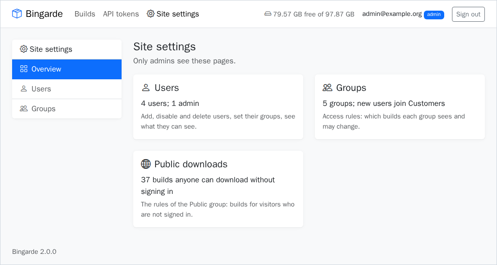

## Releases for some, everything for others

The usual setup: the team sees every build, including nightlies and feature branches, while
partners or customers see only official releases. The branch tells them apart.

| Group | Rule | Level | Sees |
|---|---|---|---|
| QA | no conditions | `read` | every build |
| CI | no conditions | `write` | every build; may create builds, upload and promote |
| Customers | project is `game` and branch starts with `release/` | `read` | builds of `game` on `release/...` branches |

**Making a rule.** On a group's page, build the filter as on the build list: groups of
conditions on any field (project, branch, platform, config, arch, status, revision, build
number, ID, date), joined with AND or OR. While you edit, the page shows how many builds the
rule finds now, with **Show them** to open them in the build list. **Start from a filter
preset** copies a saved preset into the rule; later changes to the preset do not change the
rule. **Edit** shows a rule in the filter again. A rule with no conditions finds every build.

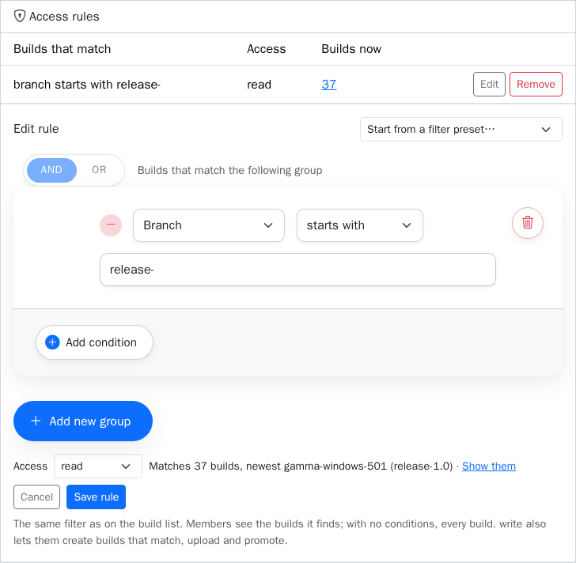

Text conditions ignore upper and lower case. Rules are checked on every request, so a rule
like "created in the last 30 days" moves with time, and a new build is visible at once to
everyone whose rules find it.

Since the branch decides here, a nightly built from a `release/...` branch is visible to the
release-only groups. Keep nightly CI on other branches, and promote what passed QA.

**Promotion.** A tested build becomes a release by moving it to a release branch, on the build
page (**Promote to branch…**) or with the API:

```bash
curl -fsS -H "Authorization: Bearer $BINGARDE_TOKEN" -H "Content-Type: application/json" \
  -X PATCH "$BINGARDE_URL/api/v2/builds/388" -d '{"branch": "release/1.4"}'
```

This needs a `write` rule that finds the build both on its current branch and on the new one;
it does not need to be the user who created the build. The new audience sees the build at once, with all its files,
and its history gets a line "promoted from main to release/1.4 by ...". If the release branch
already has the same build, the answer is `409`.

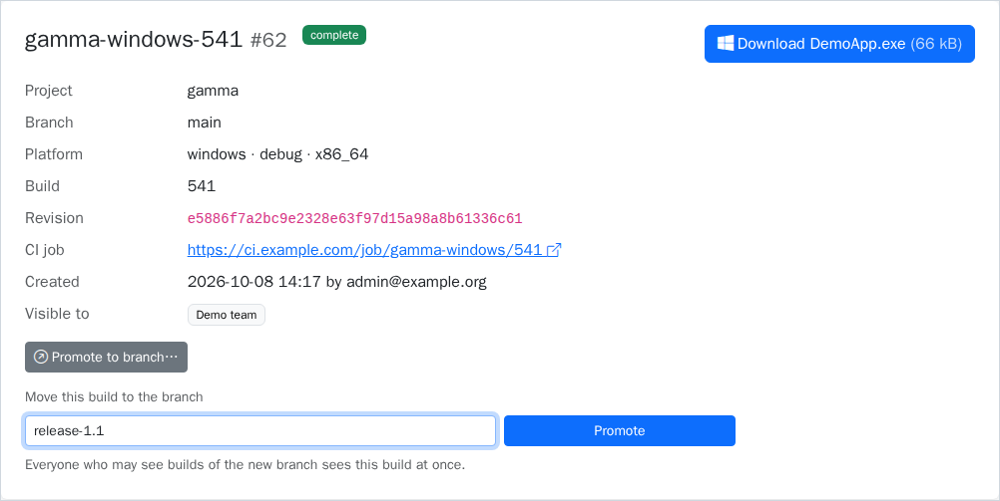

## Public downloads

The built-in group **Public** is for visitors who are not signed in: anyone on the internet.
Its rules decide which builds they may open and download, without an account. A new server's
Public group has no rules, so nothing is public until an admin adds one. Its page says in red
that its rules open builds to everyone, and a rule with no conditions asks for confirmation.

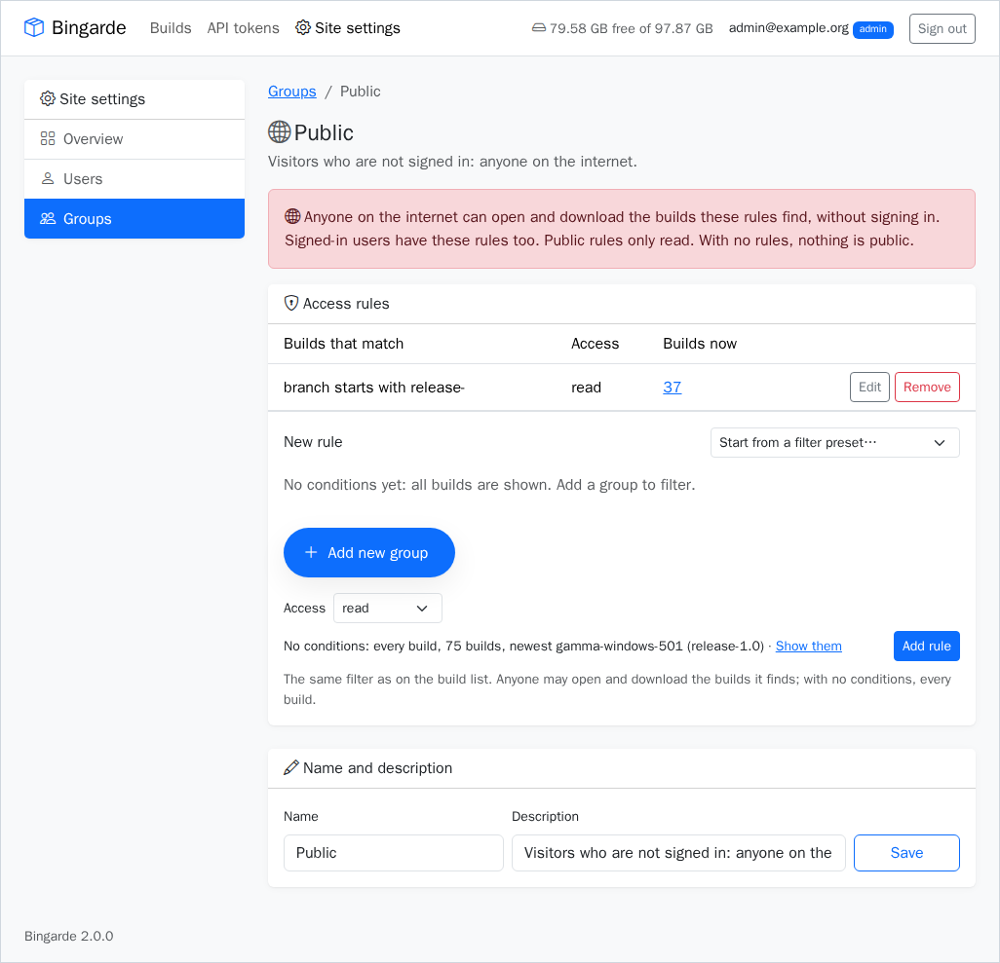

For example, a rule "branch starts with `release/`" puts every release online. Another site
can then link to them:

- `/files/<id>`: one file (the **Download** button on the build page has this link);
- `/api/v2/builds/<id>/archive`: all files of the build as a zip;
- `/builds/<id>`: the build page.

What visitors get:

- Only those three links work, and only for public builds. For any other build or file they
  are sent to the login page, so they cannot tell which builds exist. The build list, search
  and the rest of the API still need signing in.
- The build page shows no history, no CI link and no Promote; who made a build is shown to
  admins only anyway.
- Visitors get no session or cookie.

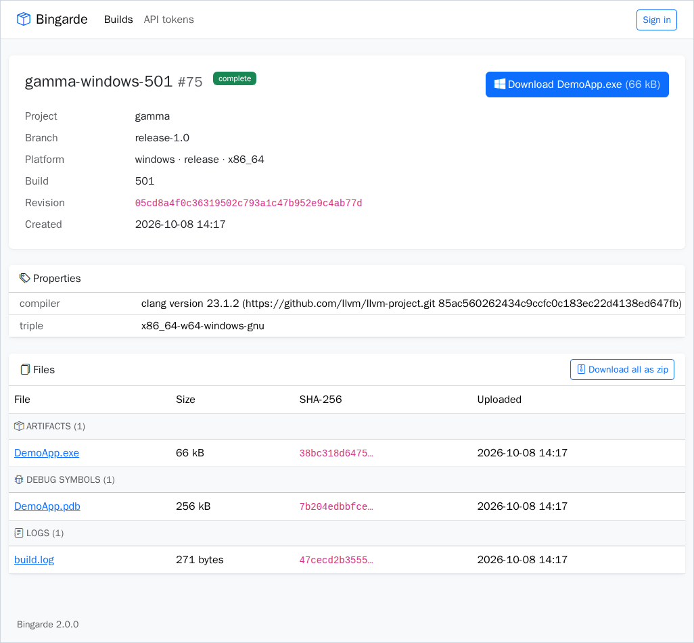

Signed-in users have the Public rules too, on top of their own groups: someone with no
groups sees the public builds. Public rules only read, and the group has no members, cannot
be renamed or deleted, and new users do not join it. To stop public downloads, remove its
rules. On a build's page, admins see **Public** under "Visible to" when a build is public.

Downloads are limited per address in nginx: 2 a second, with bursts of 30; more answer `429`.

## The Admin group

**Admin** is built in: it cannot be renamed or deleted and needs no rules. Its members see and
may change every build, delete builds and files, and they alone see the user and group lists
and manage them. Members of other groups get `403` on those pages and API calls, and nothing
else in Bingarde shows them other users' e-mails or group names.

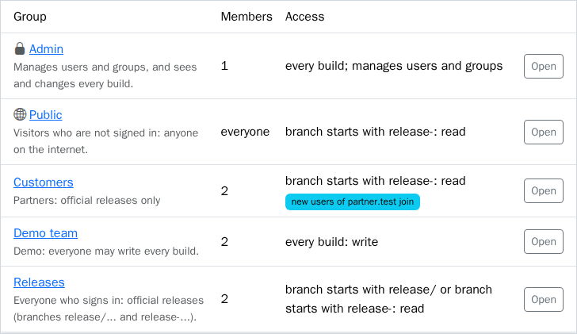

There is always at least one active admin: the last one cannot be disabled, deleted or taken
out of Admin, and nobody can disable or delete themselves.

**The first admin** of a new server is made on the command line:

```bash
docker compose exec web python -m bingarde.manage make-admin you@example.com
```

The user is created if needed; they become an admin when they sign in with that e-mail.

## New users

Nobody has to add users by hand. Anyone the provider lets in (see [login.md](login.md),
`ALLOWED_EMAIL_DOMAINS`) gets an account at their first sign-in and joins every group whose
**New users** setting matches:

- **nobody**: nobody joins by themselves (the default for new groups);
- **everyone who signs in**;
- **people whose e-mail ends with** some domains, e.g. `partner.com, partner.de`.

This happens once, when the account is made. An admin can remove someone from such a group,
and they are not added again at the next sign-in. **Add matching existing users now** on the
group page applies the setting to accounts that already exist. The Admin group cannot have it.

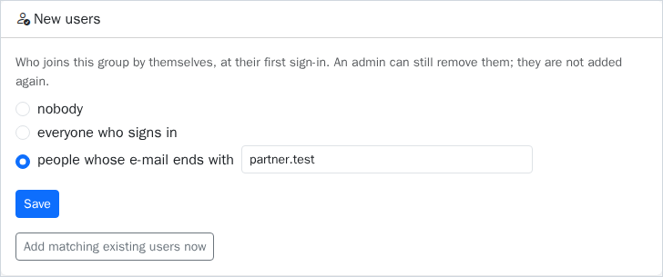

A new server has the group **Releases** (read: branch starts with `release/` or with
`release-`; everyone who signs in joins), so new people see the official releases at once.
Change its rule if your release branches are named differently. If no group takes new users, the Users and
Groups pages warn that new users see nothing.

Adding a user by hand is for giving them groups before their first sign-in: add the e-mail,
tick the groups. The account is linked to the provider at the first sign-in, and it keeps the
groups the admin gave it; the new-user groups are not added to it.

## Signing in when the account already exists

| Case | What happens |
|---|---|
| Added by an admin, first sign-in | Found by e-mail (ignoring case) and linked to the provider account; keeps its groups |
| Signs in again | Found by the provider account; groups unchanged |
| The e-mail changed at the provider | Found by the provider account; takes the new e-mail, unless another user has it (then refused: "already linked to another account") |
| Same e-mail, another account of the same provider | Refused: "already linked to another account" |
| The provider was changed | Linked to the new provider by e-mail; groups and tokens stay |
| Disabled | Refused: "This account is disabled" |
| Deleted | A new account: joins the new-user groups again |

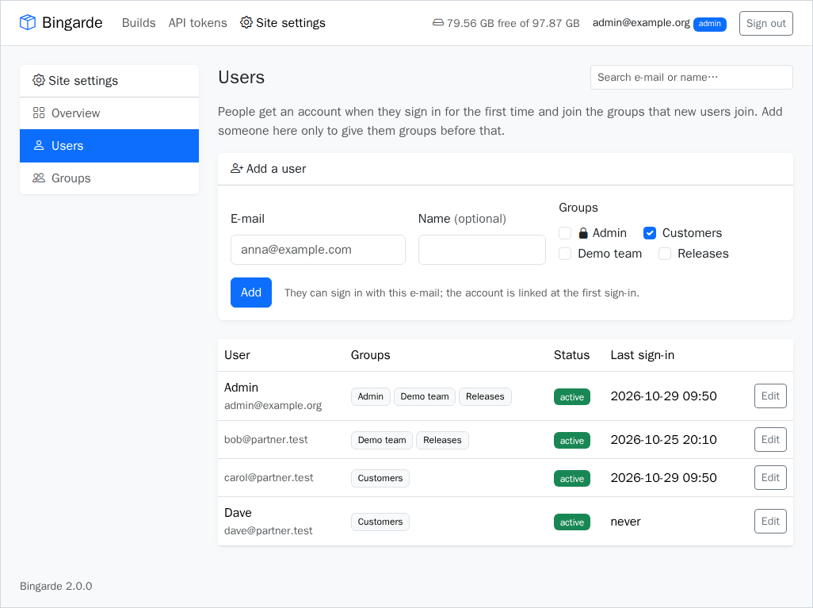

## Users

On a user's page an admin sets their groups, sees what they can see (and the build list as they
see it), revokes their tokens, and can:

- **disable** them: their sessions and tokens stop working at once; can be undone;
- **delete** them: the user, their tokens, presets and memberships go; their builds stay,
  without a creator.

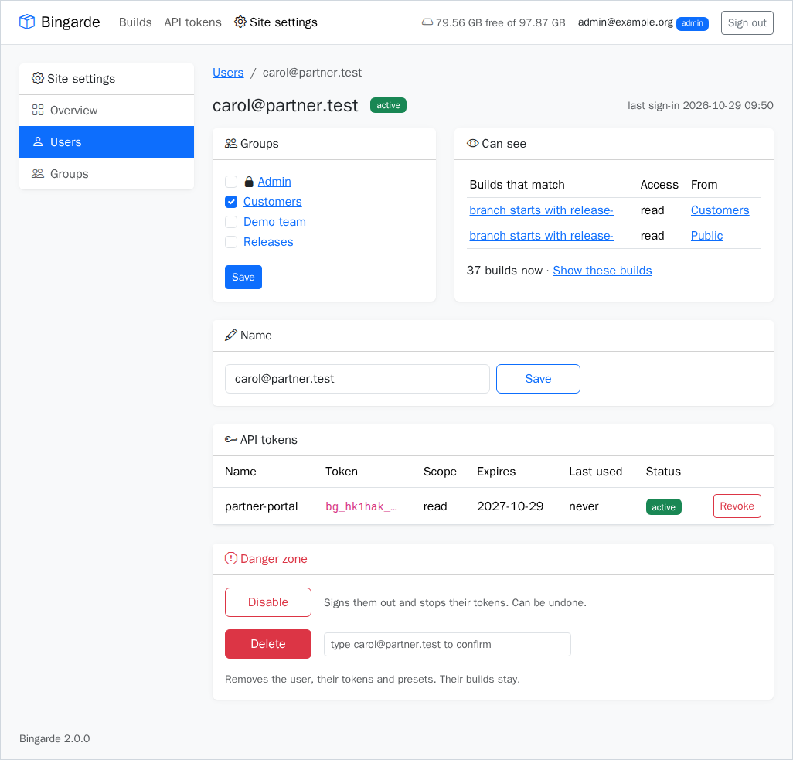

## Tokens

A token's scope limits it further: a `read` token never writes, even for a user with write
rules. A `write` token writes builds that its user's `write` rules find, and only builds its
user created (or any build for admins); promotion is the exception above. A change is checked
before and after: a writer may not change a build so that their rule no longer finds it, for
example mark it `complete` when their rule is "status is failed". Changing groups applies to
existing tokens and sessions at once.

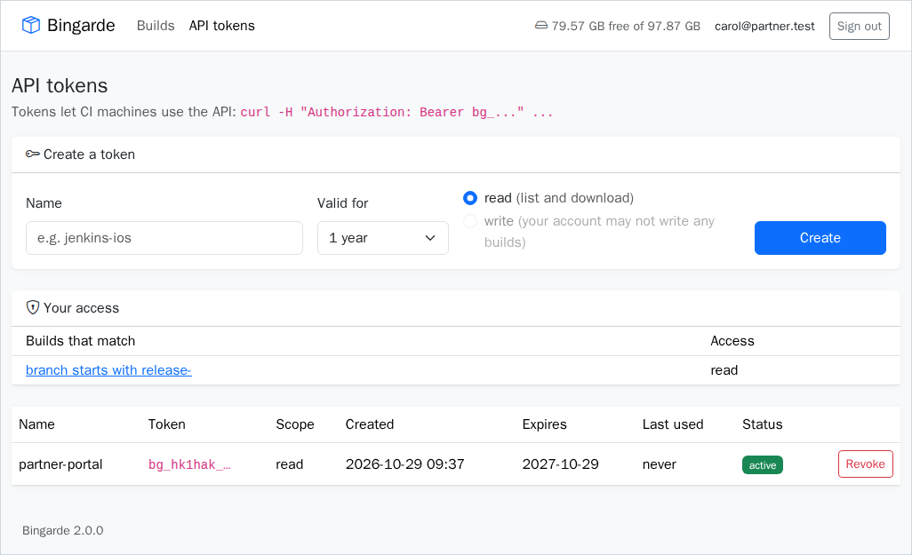

## Upgrading from version 1

Version 1 read who is admin, who may write and who is blocked from the settings
`ADMIN_EMAILS`, `WRITER_EMAILS`, `WRITER_DOMAINS` and `BLOCKED_EMAILS`. The database upgrade
reads them once and turns them into data:

- `ADMIN_EMAILS` → members of **Admin**;
- `WRITER_EMAILS`, `WRITER_DOMAINS` → the group **Writers** with a `write` rule for every
  build; the domains
  become its new-user setting (`*` = everyone);
- `BLOCKED_EMAILS` → disabled users;
- every existing user joins **Releases** (read builds whose branch starts with `release/` or
  `release-`).

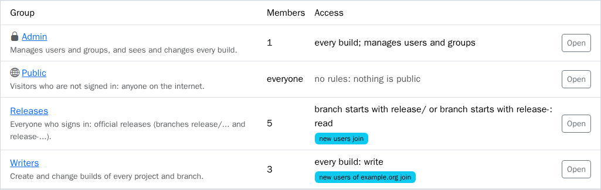

So after the upgrade, people who are not writers see **only release builds** until an
admin gives them more, for example a group with a `read` rule without conditions. Writers and CI tokens keep
seeing and uploading everything. Keep the settings set for the first start of version 2 so
the upgrade can read them, then remove them: they are ignored, and the log warns while they
are still set.
